# The effects

Every effect below is its own Claude Code skill. Ask for it by name ("add the checklist effect…") or describe what you want and Claude picks. Previews are in `examples/`.

## 01 · Orbit

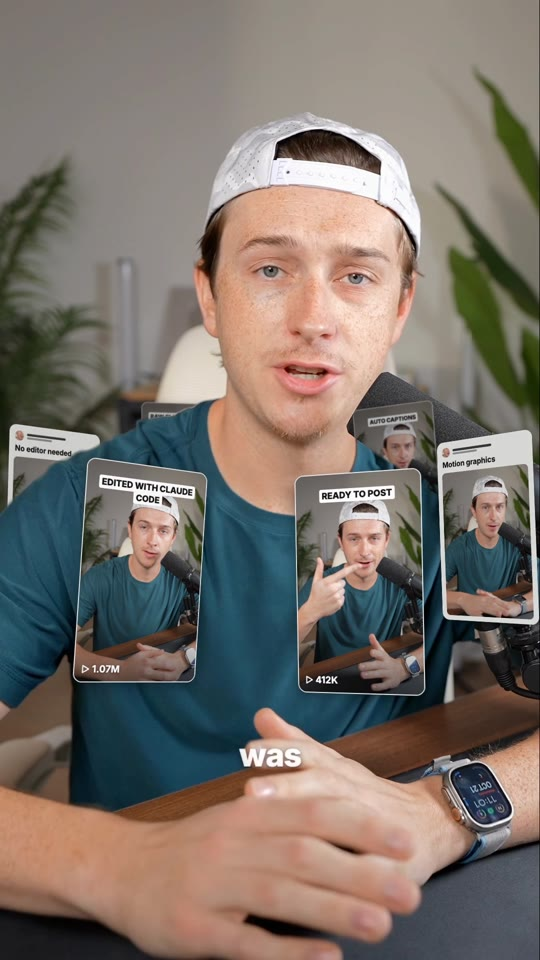

Six small portrait cards circle the speaker's chest on a tilted ring: Reel thumbnails with a white title chip and a ▷ view count, plus white text posts. The speaker is cut out of the shot, so cards on the far side slide behind their body while near cards pass in front, bigger and brighter. Far cards are smaller, darker and slightly soft. The cards whip in at the start and settle into a slow spin. Captions show a small white setup line with the key word in gold italic serif with sparkles.

**Use it when:**
- Social proof: past videos, results, testimonials, press mentions.
- Listing many things ("all these tools", "every platform") while the speaker talks.
- An eye-catching hook in the first two seconds.

**Try:** *"Add the orbit effect to `my-video.mp4` from 0:04 to 0:10."*

Preview: `examples/01-orbit.mp4` · Skill: `fx-orbit` · cuts you out of the background

---

## 02 · Couch Wall

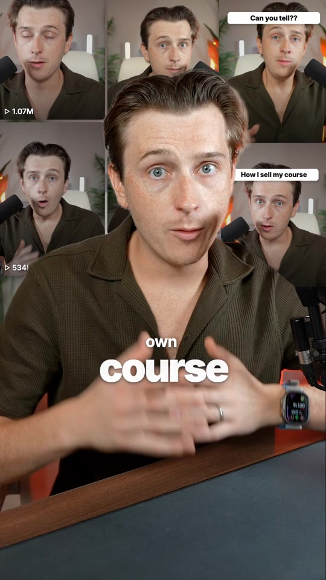

A masonry wall of 9:16-style thumbnails (rounded tiles, thin gaps) pops in tile by tile outward from the speaker's head in about half a second, covering the room behind them. Most tiles carry a white "▷ 1.07M" view-count badge, a few carry white headline stickers ("6 ways to make money with AI this week"). The speaker is cut out and stays in front; the wall drifts in very slowly while it holds. Captions are two-tier: a small setup line over one huge word ("selling a / COURSE").

**Use it when:**
- Social proof: "I've posted hundreds of videos", "this got millions of views".
- Talking about content, courses, a channel or a body of work.
- A punchy visual reset in the middle of a one-take talking head.

**Try:** *"Add the couch wall effect to `my-video.mp4` from 0:04 to 0:10."*

Preview: `examples/02-couch-wall.mp4` · Skill: `fx-couch-wall` · cuts you out of the background

---

## 03 · UI World

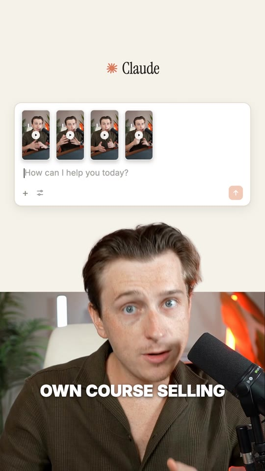

A cream chat app slides in over the top ~60% of the frame: orange starburst logo and app name, and a dashed "Drop files here" box. Video thumbnails (frames of your clip) fly in on arcs, drop into the box and it becomes a message composer; a yellow tape label sticks on, then a slash command types in with a caret and the orange send button gets pressed. The footage slides down into the bottom panel and the speaker is cut out so their head pokes up over the app background. Captions are white bold caps low on the speaker.

**Use it when:**
- Explaining a workflow that starts in an AI chat ("drop your clips in, trigger the skill").
- Showing the exact prompt or command to type.
- Any "here's the tool" moment where the software should feel like the set.

**Try:** *"Add the ui world effect to `my-video.mp4` from 0:04 to 0:10."*

Preview: `examples/03-ui-world.mp4` · Skill: `fx-ui-world` · cuts you out of the background

---

## 04 · Frame Break

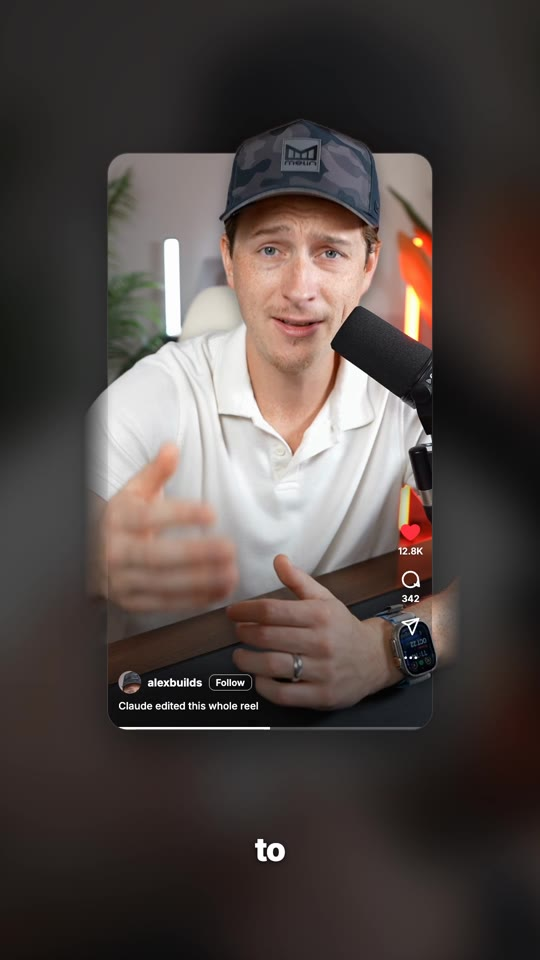

The full-screen shot springs down into a phone-shaped Reels window floating on a dark, blurred copy of the footage. The window crops the shot just above the speaker's eyes, but the cut-out speaker is layered on top. Their cap and forehead break out over the top edge, and their hands reach past the sides. Once the window settles, the feed chrome fades in: heart, comment, share and more icons with counts, a round avatar, the username, a Follow pill, a one-line caption and a progress bar. Captions sit below the phone.

**Use it when:**
- Talking about posting, going viral, or "this exact video".
- A hook that makes a plain talking head feel 3D in the first second.
- Showing the clip as it will look in the feed.

**Try:** *"Add the frame break effect to `my-video.mp4` from 0:04 to 0:10."*

Preview: `examples/04-frame-break.mp4` · Skill: `fx-frame-break` · cuts you out of the background

---

## 05 · Digital Zoom

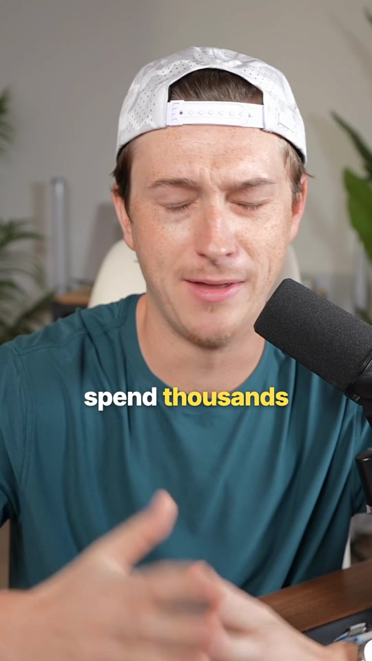

The frame snaps 25–35% closer on an emphasised word, with a 4–6 frame radial zoom blur that sells the move, then holds. On the next emphasised word it snaps back out (or further in). Captions pop on word by word in white bold, with the key word in yellow.

**Use it when:**
- A one-take talking head that needs energy without b-roll.
- Landing a punchline or the key noun of a sentence ("video *editing*").
- Faking a second camera angle between sentences.

**Try:** *"Add the digital zoom effect to `my-video.mp4` from 0:04 to 0:10."*

Preview: `examples/05-digital-zoom.mp4` · Skill: `fx-digital-zoom`

---

## 06 · Phone Mockup

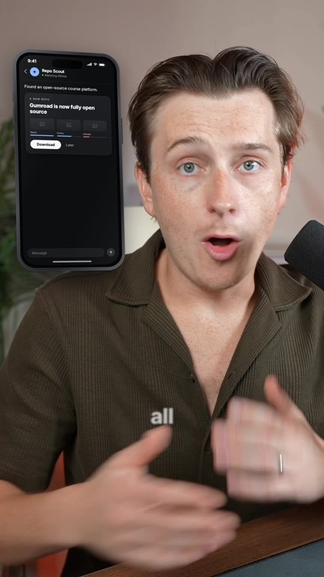

A titanium iPhone (dynamic island, status bar, home indicator) springs in from the side beside the speaker's head with a slight 3D tilt, soft shadow and gentle float, while the footage pans a little the other way to keep the face clear. On screen, a dark chat-assistant app plays out: header with avatar, a message, typing dots, a recommendation card with stat tiles, then a touch indicator taps the white button, which turns green with a check and a reply bubble pops in.

**Use it when:**
- Showing what an app, bot or automation does while explaining it.
- "It just sends me a message and I hit approve" moments.
- Putting a real screenshot or screen recording into a phone frame (`screen`).

**Try:** *"Add the phone mockup effect to `my-video.mp4` from 0:04 to 0:10."*

Preview: `examples/06-phone-mockup.mp4` · Skill: `fx-phone-mockup` · cuts you out of the background

---

## 07 · Checklist

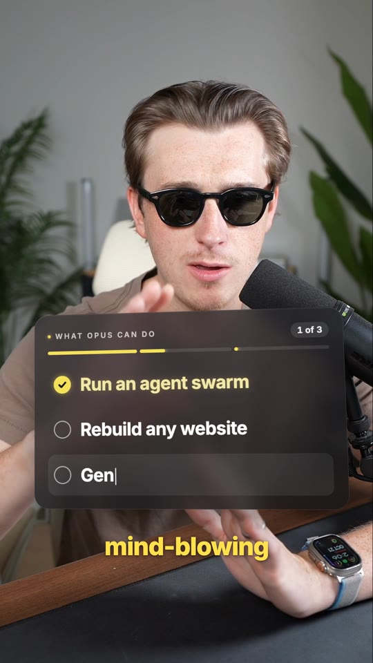

A dark frosted-glass card with a slight 3D tilt springs in above the speaker's head (or over the chest on close-ups). The header reads ALL YOU NEED TO DO with a "0 of N" counter (N = number of steps) and a segmented yellow progress bar; the rows start as grey skeleton bars. When a step is spoken its text types in with a caret, then its circle fills yellow with a check and a little burst, the counter ticks up and that bar segment fills.

**Use it when:**
- "All you need to do is…", "three steps", "here's the process" moments.
- Listing requirements, features or a recipe while talking to camera.
- Recapping what was just covered at the end of a video.

**Try:** *"Add the checklist effect to `my-video.mp4` from 0:04 to 0:10."*

Preview: `examples/07-checklist.mp4` · Skill: `fx-checklist` · cuts you out of the background

---

## 08 · Headline Wall

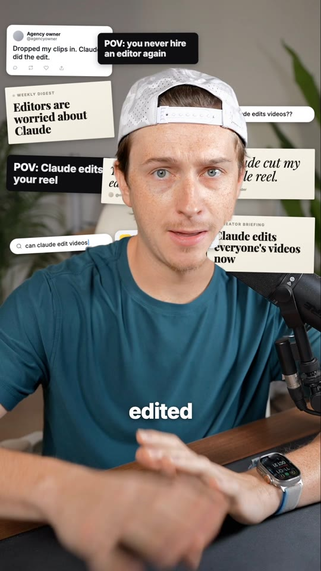

Cream paper headline notes (bold black serif, tiny uppercase kicker), italic quote cards, white tweet cards with avatar and action icons, a search pill with a blinking caret, black "POV:" cards, chat bubbles and a notification pop onto the wall behind the speaker, every 2–3 frames, each with a quick overshoot, slight tilt and a soft shadow. A larger hero card lands last and a yellow highlighter swipes across its key word. The speaker is cut out and stays in front of the whole collage.

**Use it when:**
- "Everyone is talking about X" / "X just changed everything" moments.
- Hype, news or trend videos: a new tool, launch, controversy.
- Social proof without real screenshots.

**Try:** *"Add the headline wall effect to `my-video.mp4` from 0:04 to 0:10."*

Preview: `examples/08-headline-wall.mp4` · Skill: `fx-headline-wall` · cuts you out of the background

---

## 09 · Zoom-Through Cut

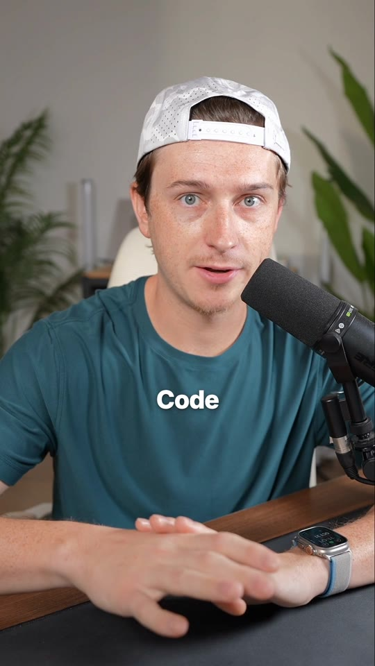

Over the last ~9 frames of shot A the frame accelerates toward the speaker's chest, smearing into a radial zoom blur with a slight clockwise spin, and A's caption blurs away with it. Hard cut. Shot B starts about 3.4× zoomed in, blurred and tilted, then decelerates out to normal framing over ~12 frames, and its caption fades in. By default A's captions use the gold serif style and B's use wide-tracked small caps, like the reference.

**Use it when:**
- Moving between two takes, outfits or locations ("…or you can get the…").
- Hiding a jump cut inside one long take (single-clip mode with `cutAt`).
- A "but wait" or contrast beat where the second shot should feel like a reveal.

**Try:** *"Add the zoom-through cut effect to `my-video.mp4` from 0:04 to 0:10."*

Preview: `examples/09-zoom-through-cut.mp4` · Skill: `fx-zoom-through-cut`

---

## 10 · Chart Grow

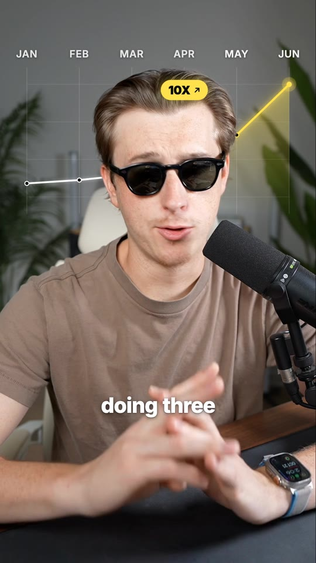

Faint vertical grid lines and labels (M T W T F S S) fade in across the top of the frame. A white line with small dots draws itself from left to right with a glowing tip, passing behind the speaker's head. At the take-off point it turns into a glowing yellow spike with a soft yellow gradient underneath, a dashed guide drops from a yellow pill (SCALE ↗) that pops in above it, and the end point pulses. The speaker is cut out and stays in front.

**Use it when:**
- Results and growth: "my views tripled", "revenue took off in week 3".
- Before/after moments where a flat period turns into a jump.
- Any stat the speaker says out loud.

**Try:** *"Add the chart grow effect to `my-video.mp4` from 0:04 to 0:10."*

Preview: `examples/10-chart-grow.mp4` · Skill: `fx-chart-grow` · cuts you out of the background

---

## 11 · Pull-back Reveal

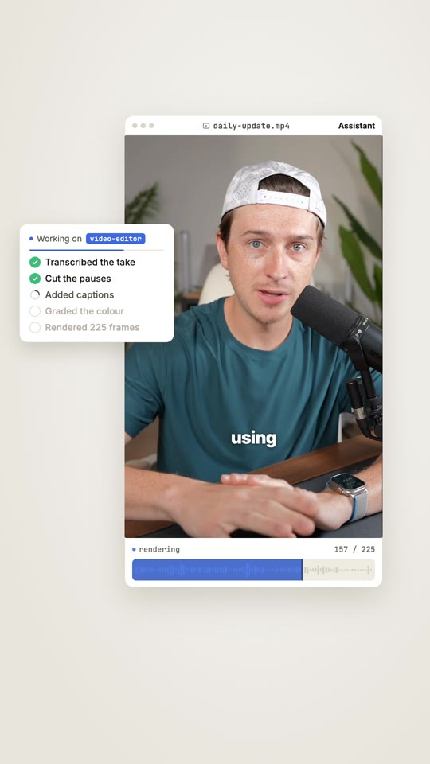

The full-frame footage smoothly shrinks into an editor window on a cream desk (title bar with the file name, the video keeps playing inside with its captions). A white agent panel slides in on the left and ticks through its steps with spinners and green checks; under the video a render bar with a waveform fills while a frame counter climbs. Near the end a big black serif number rolls up to 100 with a blue % badge, then the window border, bar and badge flip to green.

**Use it when:**
- The reveal that the video itself was made by an AI tool or skill.
- Showing a process completing ("it transcribes, cuts, captions and renders").
- Ending a video on a satisfying "done" beat.

**Try:** *"Add the pull-back reveal effect to `my-video.mp4` from 0:04 to 0:10."*

Preview: `examples/11-pull-back-reveal.mp4` · Skill: `fx-pull-back-reveal`

---

## 12 · Green Screen

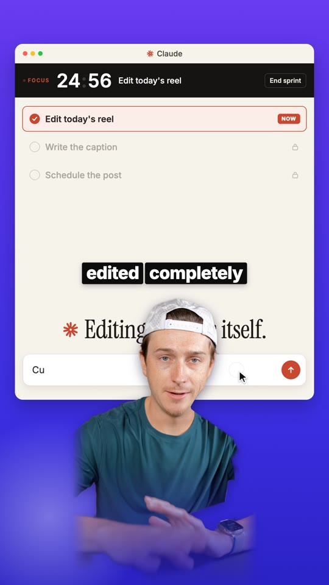

The room dissolves away while the speaker glides down into the lower centre of the frame. They are cut out and stay there at a smaller size. By default they stand in front of an animated productivity app with a purple band on top. The cream app window holds a black FOCUS bar with a ticking countdown, and a task list whose first task ticks off with a red NOW pill. A big serif line ("Everything else waits.") sits behind their head. A chat input below gets clicked by a cursor and typed into, over a blue band. Captions are word chips: white on black, with the key word on yellow.

**Use it when:**
- Talking about an app, tool, workflow or product: put the speaker in front of it.
- Replacing a messy or boring room with a branded image or gradient.
- A "focus / productivity / do this one thing" message (the default UI says exactly that).

**Try:** *"Add the green screen effect to `my-video.mp4` from 0:04 to 0:10."*

Preview: `examples/12-green-screen.mp4` · Skill: `fx-green-screen` · cuts you out of the background

---

## 13 · Paper Cut

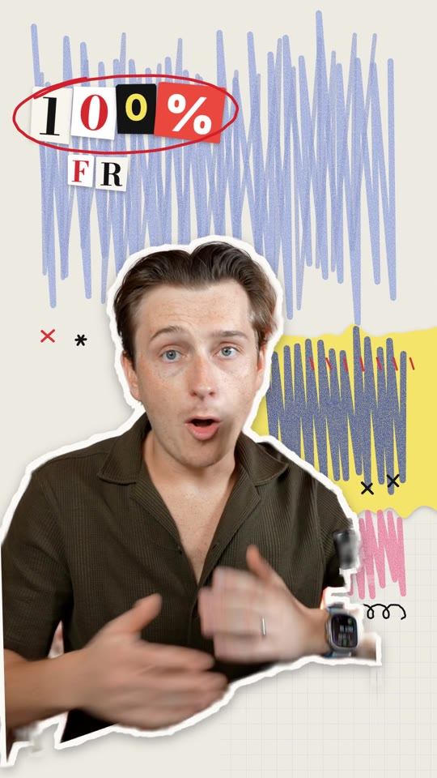

The background is swapped for off-white paper with a faint grid, a big blue crayon scribble across the top, a torn yellow strip with navy scribbles and red ticks, pink scribbles, X marks and loop doodles. The speaker, still talking, is cut out as a paper sticker with a thick, slightly ragged white border and a drop shadow, slapping into place. Ransom-note letters on mixed chips (blue, white, black, yellow; serif, slab, typewriter) land one by one, a red marker ring draws itself around them, then a smaller word pops in below. All the scribbles boil on threes like stop-motion.

**Use it when:**
- Calling out a number or claim: "100%", "3X", "$0", "FREE".
- A playful, creator-diary or "behind the scenes" moment that should feel handmade.
- A 2–5 second beat in the middle of a talk to reset attention (use `window`).

**Try:** *"Add the paper cut effect to `my-video.mp4` from 0:04 to 0:10."*

Preview: `examples/13-paper-cut.mp4` · Skill: `fx-paper-cut` · cuts you out of the background

---

## 14 · Doodle Boil

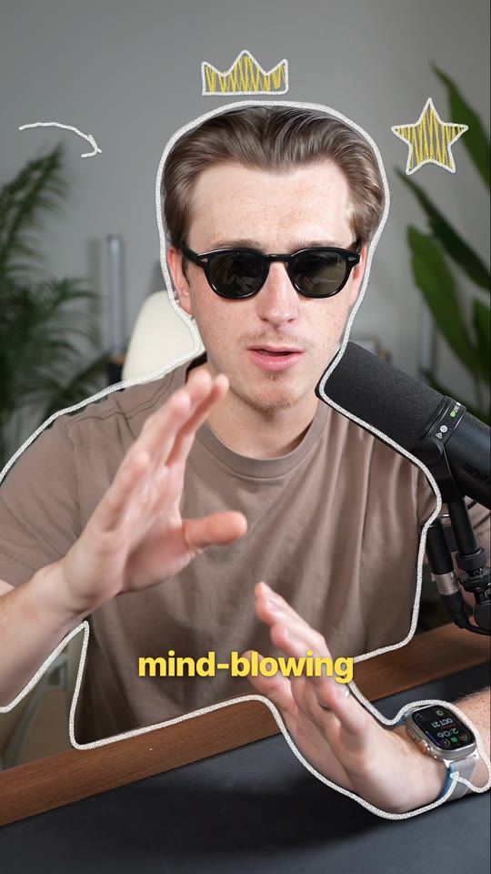

The footage plays untouched. A chunky white chalk line traces the speaker's silhouette a few pixels outside the body and re-wobbles every three frames, so it shimmers like hand-drawn animation. Doodles draw themselves on in the space beside and above the head (outline first, then a crayon scribble fill, then little spark lines) and boil along with the outline. A newer doodle in the same spot replaces the old one.

**Use it when:**
- Light, personal or funny moments where a little cartoon energy helps.
- Pointing at ideas: a heart on "love", a clapperboard on "video", a crown on "the best", a star on "three things".
- Hook or outro beats where you want movement without covering the face.

**Try:** *"Add the doodle boil effect to `my-video.mp4` from 0:04 to 0:10."*

Preview: `examples/14-doodle-boil.mp4` · Skill: `fx-doodle-boil` · cuts you out of the background

---

## 15 · Vertigo

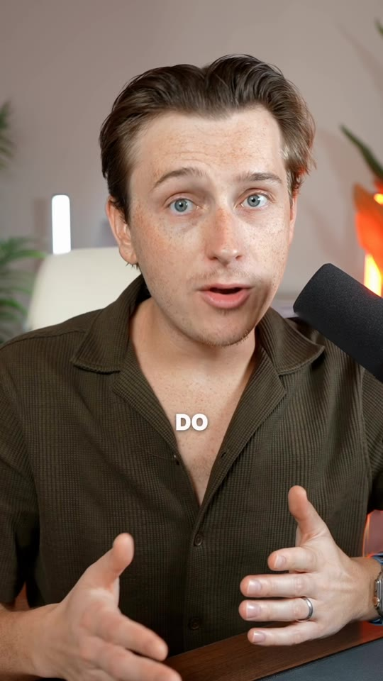

The speaker is cut out and held perfectly still at one size while the room behind them steadily zooms. With "push" the wall, lights and plants swell toward the camera; with "pull" they fall away. The move is a single eased 1–2.5 second beat, then it holds. Captions are white, bold, all caps, with the key word in yellow, sitting just below the face.

**Use it when:**
- A realisation or reveal line ("…and then it hit me").
- Emphasising one dramatic sentence in an otherwise static talking head.
- A cinematic opener on a wide shot where the room is visible.

**Try:** *"Add the vertigo effect to `my-video.mp4` from 0:04 to 0:10."*

Preview: `examples/15-vertigo.mp4` · Skill: `fx-vertigo` · cuts you out of the background

---

## 16 · Cover Story

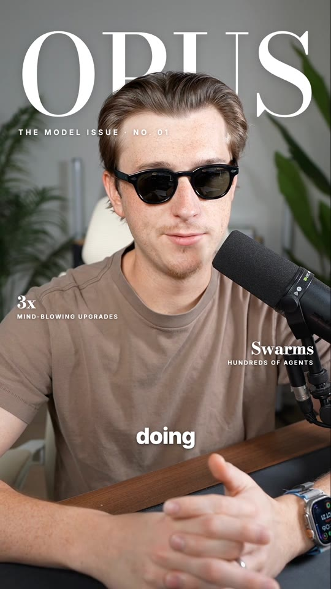

A huge white Didone word (like EDIT) fills the top of the frame and rises in letter by letter with a soft blur. The speaker is cut out and layered on top, so their head covers the bottom of the letters, exactly like a printed magazine cover. Optional small issue line under it and coverlines down the sides.

**Use it when:**
- Opening a video about a single big idea ("FOCUS", "SCALE", "EDIT").
- Introducing yourself or a topic as if you're the cover story.
- Any "text behind the person" moment where one word should own the screen.

**Try:** *"Add the cover story effect to `my-video.mp4` from 0:04 to 0:10."*

Preview: `examples/16-cover-story.mp4` · Skill: `fx-cover-story` · cuts you out of the background

---

## 17 · Glass Type

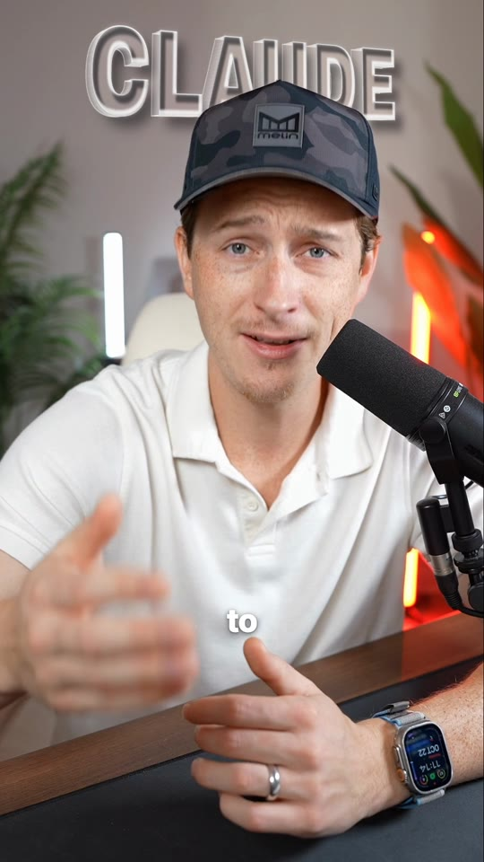

One big word made of thick clear glass stands on the wall behind the speaker at head height, turned in perspective so it recedes to one side and spans most of the frame width. The letters are tall and condensed with a visible extruded body of bright edges. Their faces bend and magnify the room behind them like a lens (strongest at the rims), with a glossy highlight band, dark inner edges that give thickness, bright specular rims and a soft shadow on the wall. The word fades in from a blur, a light sweep glides across it, and it sways a few degrees while it holds. The speaker is cut out and covers the lower part of the middle letters.

**Use it when:**
- Naming the one idea of the video ("DESIGN", "FOCUS", "AI").
- Brand or product reveals in a premium, tech look.
- Any "text behind the person" moment that should feel more 3D than a flat title.

**Try:** *"Add the glass type effect to `my-video.mp4` from 0:04 to 0:10."*

Preview: `examples/17-glass-type.mp4` · Skill: `fx-glass-type` · cuts you out of the background

---
